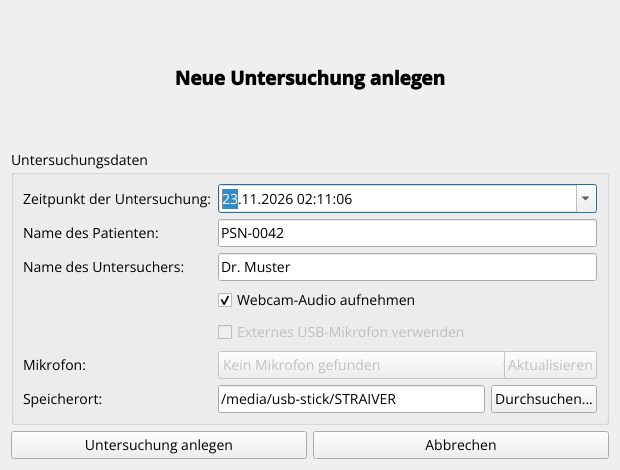
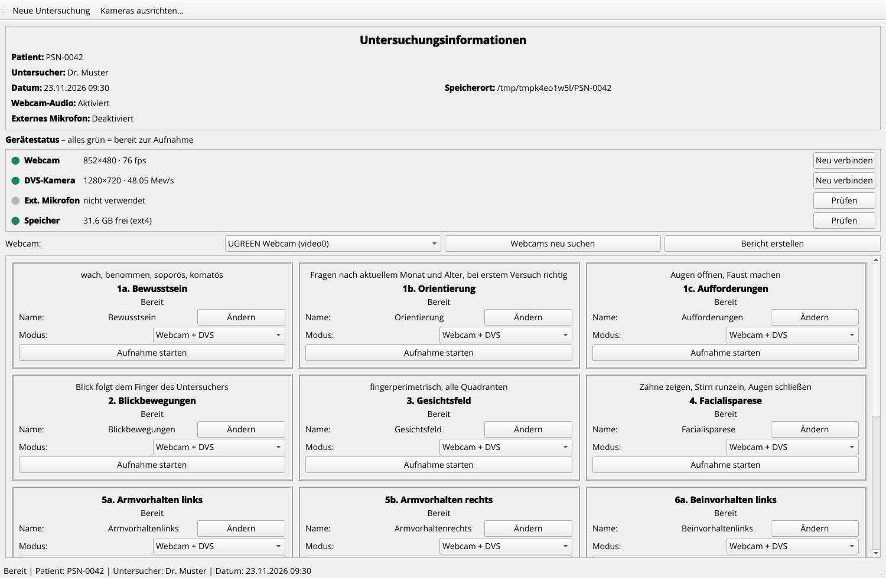
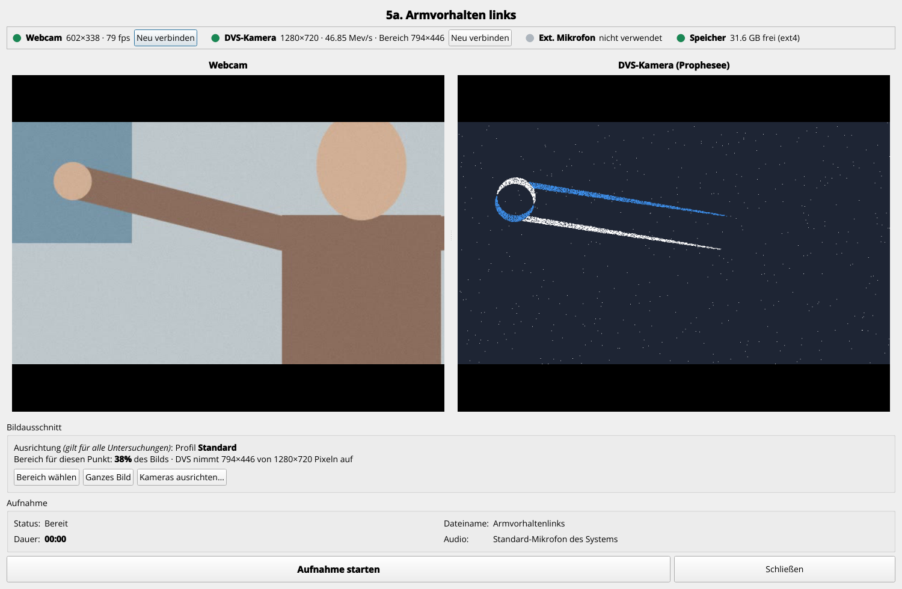
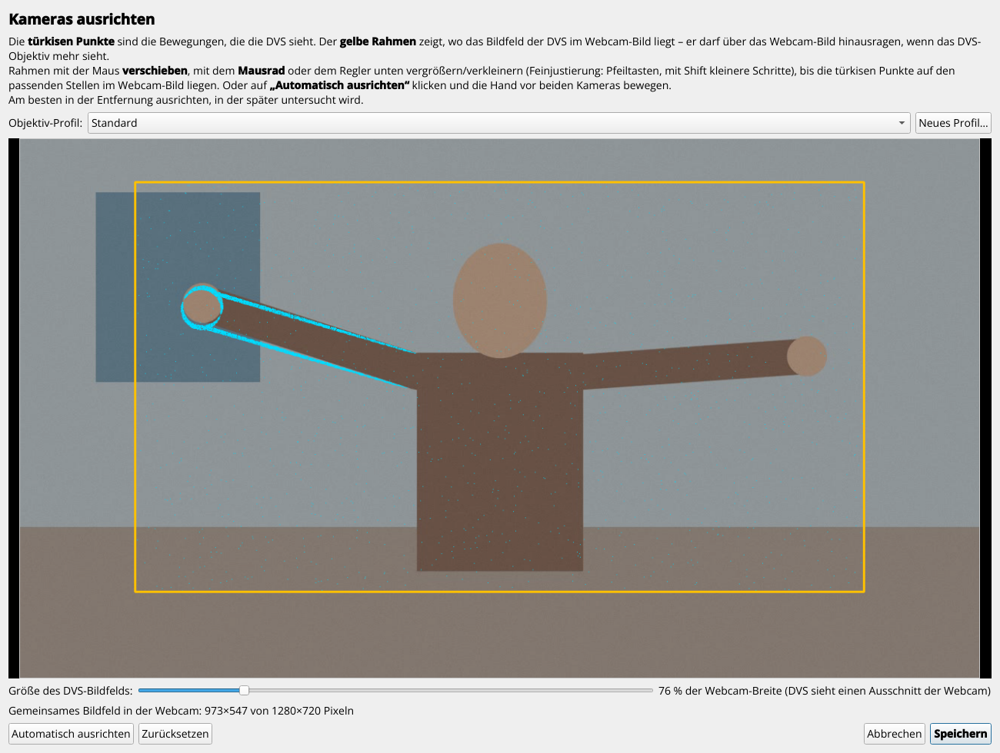

# DVS + Webcam Recorder (STRAIVER)

Aufnahme-App für das Forschungsprojekt **STRAIVER**: Patientinnen und Patienten werden während
des **NIHSS-Tests** (Schlaganfall-Skala), den eine Ärztin oder ein Arzt durchführt, gleichzeitig
mit einer **Webcam** und einer **eventbasierten Kamera (DVS, Prophesee)** aufgenommen – optional
mit externem Mikrofon. Nach jedem NIHSS-Punkt wird die ärztliche Bewertung samt Notizen
gespeichert. Aus diesen Daten entsteht später ein Modell, das den Test automatisch auswertet.

Die App ist für die Bedienung durch medizinisches Personal ohne Technik-Kenntnisse gebaut:
Gerätestatus als Ampel, „Neu verbinden“ statt Kabel umstecken, Warnungen statt stiller Fehler.

## Screenshots

| Untersuchung anlegen | Hauptfenster mit Gerätestatus |
|---|---|
|  |  |

**Aufnahme eines NIHSS-Punkts** – links Webcam, rechts DVS, hier mit gewähltem Bereich (Arm):



**Kameras ausrichten** – die DVS-Events (türkis) liegen über dem Webcam-Bild, der gelbe Rahmen
ist das Bildfeld der DVS:



<sub>Die Kamerabilder in den Screenshots sind synthetisch erzeugt (keine echten Personen).</sub>

## Funktionen

- Gleichzeitige Aufnahme **Webcam (MP4) + DVS (RAW)** + optional externes Mikrofon (WAV)
- Alle 15 NIHSS-Punkte als Karten; nach jeder Aufnahme **Bewertung + Notizen** (JSON)
- **Gerätestatus-Ampel** für Webcam, DVS, Mikrofon und Speicher, mit **„Neu verbinden“**
  (Software-USB-Reset – wirkt wie Kabel aus-/einstecken)
- Kameras bleiben die ganze Untersuchung verbunden, **automatische Wiederverbindung**,
  Warnung, falls eine Kamera fehlt oder während der Aufnahme ausfällt
- **Kameras ausrichten** (pro Objektiv-Profil): Webcam- und DVS-Bildfeld zur Deckung bringen,
  von Hand oder automatisch
- **Bereich wählen** (optional pro NIHSS-Punkt): beide Kameras nehmen nur diesen Bereich auf
  (Webcam-Zuschnitt, DVS-Hardware-ROI)
- Pro Aufnahme eine **Metadaten-Datei** (Zeitstempel, Ausrichtung, Bereich, Auflösung, fps)
- **PDF-Bericht** mit allen Bewertungen einer Untersuchung
- Speicherprüfung (freier Platz, FAT32-Warnung), Log jeder Sitzung

## Voraussetzungen

| | |
|---|---|
| Rechner | Linux, **Ubuntu 22.04 / 24.04** (amd64). 26.04 und arm64 funktionieren ebenfalls (OpenEB wird dann aus dem Quellcode gebaut). |
| DVS | Prophesee EVK3 HD / EVK4 (IMX636) an einem **USB-3-Port** |
| Webcam | USB-Webcam mit MJPG (z. B. UGREEN, Logitech C920) |
| Speicher | USB-Stick/SSD, am besten **exFAT** (FAT32 erlaubt nur 4 GB pro Datei) |

Webcam, DVS und ggf. Mikrofon können über einen **aktiven USB-Hub** (mit eigenem Netzteil)
angeschlossen werden. Die DVS braucht USB 3 – die App warnt, wenn sie nur mit USB 2 läuft.

## Installation

```bash
# 1. Repository holen
git clone https://github.com/m-werzinger-ccn/dvs-webcam-recorder-app.git
cd dvs-webcam-recorder-app

# 2. Alles einrichten: Systempakete, Metavision/OpenEB, Python-Umgebung, USB-Regeln
bash setup/setup_linux_dev.sh

# 3. Icon auf dem Schreibtisch und im App-Menü anlegen
bash setup/install_desktop_shortcut.sh
```

Danach **einmal ab- und wieder anmelden** (damit die Gruppenrechte für Kamera und USB greifen).

- Ist das **Metavision SDK schon installiert** (z. B. per apt von Prophesee), erkennt das das
  Skript und baut OpenEB nicht noch einmal – dann dauert die Einrichtung nur wenige Minuten.
  Sonst wird OpenEB aus dem Quellcode gebaut (ca. 20–40 Minuten).
- Zeigt das Icon auf dem Schreibtisch ein Warnsymbol: Rechtsklick → **„Start erlauben“**.
- Prüfen, ob die DVS erkannt wird: `metavision_platform_info`

**Aktualisieren:** `git pull` im App-Ordner – fertig (das Setup nur erneut ausführen, wenn sich
in `setup/` etwas geändert hat).

**Starten:** über das Icon **„STRAIVER Recorder“** oder im Terminal mit `bash setup/run.sh`.

## Benutzung

1. **Kameras einstecken**, App über das Icon starten.
2. **Untersuchung anlegen:** Patienten-ID (bitte ein **Pseudonym**, keinen Klarnamen), Name der
   untersuchenden Person, Zeitpunkt und **Speicherort** (z. B. USB-Stick) wählen. Optional
   externes Mikrofon auswählen.
3. **Gerätestatus prüfen:** alles grün = bereit.
   Rot? Auf **„Neu verbinden“** klicken. Hilft das nicht, Kabel prüfen.
4. **Einmalig: Kameras ausrichten** (Werkzeugleiste → „Kameras ausrichten…“) – nur nötig beim
   ersten Aufbau oder nach einem Objektivwechsel. Rahmen verschieben und mit dem Regler
   **„Größe des DVS-Bildfelds“** skalieren, bis die türkisen DVS-Punkte auf den passenden
   Stellen im Webcam-Bild liegen – oder **„Automatisch ausrichten“** und die Hand vor beiden
   Kameras bewegen. Für jedes Objektiv ein eigenes **Objektiv-Profil** anlegen. Am besten an
   der Untersuchungsposition ausrichten (die Kameras sitzen übereinander, die Ausrichtung
   stimmt exakt für diese Entfernung).
5. **Pro NIHSS-Punkt:** auf der Karte **„Aufnahme starten“** klicken. Im Aufnahmefenster
   - optional **„Bereich wählen“** und ein Rechteck aufziehen (z. B. um Gesicht oder Arm) –
     wird für diesen Punkt gemerkt; **„Ganzes Bild“** hebt ihn auf,
   - **„Aufnahme starten“** / **„Aufnahme stoppen“**,
   - danach **Bewertung und Notizen** eintragen. Die Karte wird grün.
6. Am Ende **„Bericht erstellen“** (PDF mit allen Bewertungen).

Fehlt beim Start einer Aufnahme eine Kamera, fragt die App nach, statt nur mit einer Kamera
aufzunehmen. Fällt eine Kamera während der Aufnahme aus, erscheint ein roter Hinweis.

### Was wird gespeichert?

```
<Speicherort>/<Patienten-ID>/<NIHSS-Punkt>/
├── <Name>.mp4            Webcam-Video (auf Ausrichtung/Bereich zugeschnitten)
├── <Name>.raw            DVS-Events (Prophesee RAW, ggf. nur der gewählte Bereich)
├── <Name>_audio.wav      externes Mikrofon (falls aktiviert)
├── <Name>_rating.json    Bewertung + Notizen
└── <Name>_meta.json      Zeitstempel, Ausrichtung, Bereich, Zuschnitt, Auflösung, fps, DVS-ROI
```

Ausrichtung und gemerkte Bereiche liegen in `~/.config/straiver-recorder/alignment.json`,
Einstellungen wie die Webcam-Auflösung in `config.py`.

## Fehlerbehebung

| Problem | Lösung |
|---|---|
| Kamera rot / „nicht gefunden“ | „Neu verbinden“ klicken; sonst USB-Kabel und Hub (Netzteil!) prüfen |
| DVS orange „nur USB 2.0“ | anderen USB-3-Port oder anderes Kabel verwenden |
| Speicher orange „FAT32“ | Stick als exFAT formatieren |
| „Neu verbinden“ meldet fehlende Berechtigung | `bash setup/install_usb_rules.sh`, ab- und wieder anmelden |
| Etwas anderes | `bash tools/diagnose_hardware.sh > diagnose.txt 2>&1` **vor** dem Umstecken ausführen |

Jede Sitzung wird in `logs/app_<Datum>.log` mitgeschrieben (alle 10 s eine Statuszeile mit
fps, DVS-Eventrate und Speicherverbrauch). Mit `tools/dvs_stream_test.py` lässt sich die DVS
ohne Oberfläche testen.

## Entwicklung

- **macOS:** läuft mit Webcam, aber ohne DVS (Metavision gibt es nicht für macOS) – die
  DVS-Ampel ist dann grau, Modus „Nur Webcam“.
- **Kompletter Test auf dem Mac:** Ubuntu-VM (z. B. Parallels, ARM) mit durchgereichten
  USB-Geräten; `setup/setup_linux_dev.sh` baut OpenEB dort aus dem Quellcode.

```
main.py                  Einstiegspunkt
config.py                NIHSS-Kategorien, Auflösung, fps
recorder/                Kamera-Sitzung, Webcam-, DVS- und Audio-Recorder
ui/                      Fenster und Dialoge (PyQt5)
utils/                   Geräteerkennung, USB-Reset, Ausrichtung, Speicherprüfung, PDF
setup/                   Installation, udev-Regeln, Startskript, Desktop-Icon
tools/                   Hardware-Diagnose, DVS-Streamtest
```
